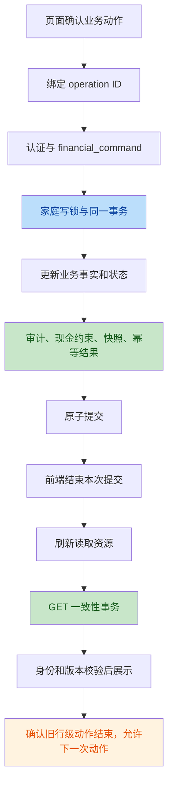
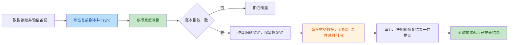

# Invest 架构再次复审

后续状态（2026-10-01）：本文 F1–F5 已实施修复，具体契约、回归结果及 PostgreSQL
环境缺口见 [修复验收](architecture-fixes-2026-10-01.md)。以下保留发现时的原始证据。

范围：当前工作区的实际实现，包括未提交修改和新增模块；沿用 2026-09-30 审查任务日期命名。本轮验证时，本机时钟已为 `2026-10-01 +08:00`，跨月暴露了此前未发现的测试缺陷。本文不代表线上部署验收。

本轮重新执行测试并补充故障复现。历史验收报告中的通过数量不作为本轮结果。只新增本报告，临时复现文件已删除；没有修复业务代码、改动真实账本或发布。

## 1. 总体结论

| 项目 | 判断 |
|---|---|
| 架构合理度 | **良好** |
| 综合评分 | **84 / 100**，按家庭财务应用规模给出的工程判断 |
| 一句话结论 | 模块化单体和资金事务边界适合当前项目；仍有提交生命周期、历史证明、恢复审计和测试确定性问题，应局部完善。 |
| 最突出的优点 | 资金事实、当前状态、审计、幂等结果与快照统一提交；组合读取显式共享一致性事务。 |
| 最大的架构风险 | 验证体系尚不能稳定证明实现：本轮后端已有两个确定失败，PG 并发测试还包含错误调度假设，真实 PG 与容器恢复尚缺运行证据。 |
| 是否需要立即重构 | **否**。需修复缺陷，无需再开展全项目结构改造。 |
| 本轮发现 | **1 项 P1、4 项 P2；未确认新的 P0。** P1 是已阻断回归的测试缺陷，不是已证实的资金错误。 |
| 判断依据 | 读取实际调用链、全量本地单测、三端真实接口浏览器流程，以及五项问题的代码与行为证据。 |

上轮 R1–R7 的主要结构措施仍在实际链路中：统一提交、稳定错误码、一致性读取、业务日历、领域 SQL 剥离、真实浏览器/产物检查入口、家庭恢复锁和 feature 草稿归属。不能因为本轮仍有缺陷，就推断这些改造没有生效。

## 2. 架构还原

当前采用**模块化单体 + 应用用例/查询分离 + 直接 SQL 持久化**，不是微服务，也不是完整事件溯源。`transactions`、`investment_trades` 保存业务事实，账户和持仓保存当前状态，快照保存派生估值。

| 模块 | 实际职责与依赖 | 证据 |
|---|---|---|
| React app / pages / features | app 装配会话、导航和跨功能动作；feature 管草稿、业务动作、展示转换和资源读取 | [useActionWorkspace](file:///Users/bytedance/Desktop/invest-app/frontend/src/app/useActionWorkspace.js)、[useFinanceData](file:///Users/bytedance/Desktop/invest-app/frontend/src/app/useFinanceData.js) |
| API / operations / shared hooks | 捕获身份与请求版本、维护操作键、拒绝过期响应、协调提交与刷新 | [api](file:///Users/bytedance/Desktop/invest-app/frontend/src/api.js)、[operationStore](file:///Users/bytedance/Desktop/invest-app/frontend/src/operations/operationStore.js)、[useSubmission](file:///Users/bytedance/Desktop/invest-app/frontend/src/features/shared/useSubmission.js) |
| HTTP / tenancy | 输入校验、认证、角色及家庭/个人范围；路由调用应用用例 | [main](file:///Users/bytedance/Desktop/invest-app/backend/main.py#L112-L122)、[tenancy](file:///Users/bytedance/Desktop/invest-app/backend/tenancy.py) |
| application / domain | 应用层组织授权、存储与审计事实；领域层提供金额、记账、估值、日历等规则 | [命令协调](file:///Users/bytedance/Desktop/invest-app/backend/application/commands.py#L165-L224)、[纯记账规则](file:///Users/bytedance/Desktop/invest-app/backend/domain/accounting.py) |
| queries / infrastructure | 组合报表、核对模型、连接与事务、具体持久化及恢复映射 | [读取边界](file:///Users/bytedance/Desktop/invest-app/backend/infrastructure/read_models.py)、[事务](file:///Users/bytedance/Desktop/invest-app/backend/infrastructure/database.py#L74-L130) |
| integrations / jobs / deploy | 行情抓取、快照和响应清理、迁移、部署及备份恢复 | [行情协调](file:///Users/bytedance/Desktop/invest-app/backend/application/market_data.py)、[快照任务](file:///Users/bytedance/Desktop/invest-app/backend/snapshot_scheduler.py)、[备份工具](file:///Users/bytedance/Desktop/invest-app/deploy/scripts/postgres_backup.py) |

实际写入与读取流程如下。绿色步骤是已经建立的统一边界，橙色步骤是 F1 仍需补齐的生命周期。



恢复沿用应用层协调，文件 I/O 在家庭锁外，覆盖前再次核对账本指纹。F3 位于审计 JSON 引用映射，不是整个恢复事务失效。



PostgreSQL 用家庭 advisory lock 协调写入、用 REPEATABLE READ READ ONLY 进行组合读取；SQLite 写入使用 BEGIN IMMEDIATE，读取使用显式事务。SQLite 的通过不能证明 PG 并发行为。行情在锁外抓取，写回时比较原持仓字段；后台快照按家庭分别提交。启动流程校验配置/结构版本并按环境选择迁移和调度，见 [lifespan](file:///Users/bytedance/Desktop/invest-app/backend/main.py#L29-L56)。

## 3. 做得合理的地方

| 架构点 | 具体证据 | 价值 |
|---|---|---|
| 资金提交边界集中 | [financial_command](file:///Users/bytedance/Desktop/invest-app/backend/application/commands.py#L165-L262) | 审计或快照失败可以随资金变化一起回滚，内层用例不自行提交。 |
| 读取连接显式传递 | [consistent_query](file:///Users/bytedance/Desktop/invest-app/backend/infrastructure/read_models.py#L9-L25) | 主查询和子查询共享快照，降低并发时虚假余额差异。 |
| 领域计算已独立 | [accounting](file:///Users/bytedance/Desktop/invest-app/backend/domain/accounting.py)、[accounting_store](file:///Users/bytedance/Desktop/invest-app/backend/infrastructure/accounting_store.py) | 规则可独立验证，保留直接 SQL 的简单性。 |
| 前端资源按页面启用 | [useFinanceData](file:///Users/bytedance/Desktop/invest-app/frontend/src/app/useFinanceData.js#L26-L89)、[禁用资源跳过请求](file:///Users/bytedance/Desktop/invest-app/frontend/src/features/shared/useScopedDataResource.js#L29-L31) | 聚合刷新函数并不等于无条件加载全部功能，不应只按函数形状认定过度请求。 |
| 新表单防重复路径有效 | [提交终态](file:///Users/bytedance/Desktop/invest-app/frontend/src/features/shared/useSubmission.js#L55-L70)、[真实浏览器故障用例](file:///Users/bytedance/Desktop/invest-app/frontend/e2e/real-api.spec.js#L209) | 本轮三端流程确认写成功后 GET 失败不会再次记账。 |
| 恢复保留重试语义 | [prepare / restore](file:///Users/bytedance/Desktop/invest-app/backend/application/backup.py#L732-L800)、[恢复回归](file:///Users/bytedance/Desktop/invest-app/backend/tests/restore_cases.py#L44-L102) | 锁外持久化副本、锁内复核、同键返回原结果，减少误覆盖后续新记录。 |
| 有真实行为验证入口 | [CI](file:///Users/bytedance/Desktop/invest-app/.github/workflows/ci.yml)、[真实浏览器 runner](file:///Users/bytedance/Desktop/invest-app/frontend/scripts/real-api-e2e.mjs) | 隔离账本与服务，不只依赖源码结构断言；但仍需修正 F4/F5。 |

当前应用层直接调用具体 SQL、App 装配跨功能动作、顶层兼容导出，本身不构成需要重构的问题。未发现必须引入通用 Repository、DI 容器或外部状态管理库的证据。

## 4. 问题与风险清单

保留既有复审 F1–F4 编号，本轮新增 F5。优先级按实际影响而非代码行数确定。

| 优先级 / 编号 | 问题与性质 | 具体证据 | 影响 | 建议方案 | 成本 |
|---|---|---|---|---|---|
| **P1 / F5** | **确定的测试缺陷：固定月份与实时建账日期混用** | [创建目标后查询固定月份](file:///Users/bytedance/Desktop/invest-app/backend/tests/test_family_accounts.py#L274-L303)、[第二处固定预期](file:///Users/bytedance/Desktop/invest-app/backend/tests/test_family_accounts.py#L698-L700) | 本轮后端两项必败；9 月通过、10 月失败，阻断 CI 并削弱回归可信度 | 在测试 fixture 固定业务时钟和相关日期；独立保留跨日跨月行为测试 | 0.5–1 天 |
| **P2 / F1** | **确定的功能缺陷：行级动作在刷新失败后无法结束旧意图** | [仅刷新成功才释放](file:///Users/bytedance/Desktop/invest-app/frontend/src/features/shared/useSubmission.js#L117-L128)、[终态直接返回](file:///Users/bytedance/Desktop/invest-app/frontend/src/features/shared/useSubmission.js#L32-L34) | 标记完成成功但刷新失败，页面内重载并恢复目标后，再次标记完成被静默忽略 | 让相关资源成功确认状态后释放已提交意图；未知结果仍复用原键 | 0.5–1.5 天 |
| **P2 / F2** | **确定的语义缺陷：增量调整被当成历史完整性证明** | [reconstructable](file:///Users/bytedance/Desktop/invest-app/backend/queries/reconciliation.py#L88-L92) | 原缺失 1000 元历史仍在，却因增加 50 元调整清除历史不足提示 | 分离当前是否对得上与历史来源是否完整；只对可信基线后的历史作承诺 | 0.5–1 天 |
| **P2 / F3** | **确定的审计缺陷：恢复遗漏嵌套对象 ID 映射** | [子对象类型丢失](file:///Users/bytedance/Desktop/invest-app/backend/infrastructure/restore_store.py#L67-L73)、[目标审计载荷](file:///Users/bytedance/Desktop/invest-app/backend/application/goals.py#L19-L33) | 审计主体是新目标 ID，嵌套 goal.id 仍为旧 ID，追溯信息内部不一致 | 根据审计载荷结构显式映射嵌套实体；增加字段级恢复断言 | 1–2 天 |
| **P2 / F4** | **确定的测试缺陷、潜在 PG CI 不稳定：固定要求一项并发冲突** | [错误数量断言](file:///Users/bytedance/Desktop/invest-app/backend/tests/test_cross_workflows.py#L664-L670) | 核对先执行时三项均成功是合法结果，测试却失败 | 分别控制两类执行顺序，再做不预设顺序的资金不变量验证 | 0.5–1 天，另需 PG 环境 |

F1–F3 均为已有机制内的边界缺口，尚无本轮证据证明它们造成真实账本资金损失。F4 已证明断言错误，但本轮没有运行真实 PG 来观察随机失败。F5 的两项失败属于同一测试时钟根因，合并为一项问题。

**二次复核：**五项均有主审复现与一份独立复核确认。另一并行复核未返回可读取结论，采用主审反证复查作为补充，不计作两路独立一致。独立复核指出 F1 的页面入口和恢复条件应收窄，本文已改用实际存在的“完成→恢复→完成”，并明确整页刷新或身份切换可解除缓存。

**验证缺口：**真实 PG 锁/MVCC、Docker 恢复演练、线上配置与原生设备行为本轮无法判断。需要隔离 PG 作业结果、真实恢复报告、线上响应证据和设备验证；CI 文件存在不等于这些检查已通过。

**可选优化：**持续把新局部逻辑放回 feature，观察家庭锁时长和恢复耗时。无需为目录一致性迁移全部文件，也无需立即拆分 CSS。

## 5. 重点问题深入分析

### F5：测试时钟未固定，当前后端回归已失败

1. **当前实现：**`FamilyAccountTests.setUp` 建临时库但不固定业务时间；`create_goal` 使用 [business_now](file:///Users/bytedance/Desktop/invest-app/backend/application/goals.py#L178-L180)，测试却始终查询 `2026-09`。
2. **问题原因：**[目标读取](file:///Users/bytedance/Desktop/invest-app/backend/queries/finance.py#L953-L974) 根据创建月份和当前范围内的目标记录确定起算月。10 月创建且没有 9 月个人记录的目标，不应出现在 9 月汇总。
3. **触发与复现：**两个原测试在 `2026-09-30T12:00:00+08:00` 均通过；只把业务时钟改为 `2026-10-01T12:00:00+08:00`，均失败。实际值分别是 0，预期为 10000/5000。重新分配目标的数据库断言已通过，不能把随后个人视图的时间过滤当成分配丢失。
4. **目标结构：**业务测试 fixture 明确基准日期，待测业务日期与执行机器时间解耦；专门的日历测试负责时区和跨月行为。
5. **最小方案：**这两个用例在 fixture 中固定 `domain.calendar` 的时钟，并使开户、创建目标、记账和查询处于有意设置的时间线。不要只把硬编码月份机械替换成当前月，也不要删除目标起算月过滤。
6. **完整方案：**提供可复用的测试时钟上下文；审查其他“实时创建 + 固定月份查询”的用例；对业务日期边界单独参数化 9 月末、10 月初和 UTC/上海转换。复用现有日历函数，无需引入新的运行时框架。
7. **风险与验证：**大范围冻结全局 datetime 会掩盖任务时长、认证过期等问题；只控制必要业务时钟。先证明两个原失败，再验证普通流程与边界流程，并运行全量后端及真实 PG 作业。修改正确的业务过滤来满足错误 fixture 会引入历史报表回归。

### F1：防重复保护阻止了下一次合法动作

复现调用真实 `useGoalWorkspace`、`useCommandActions` 和 API 层，模拟传输及一次失败刷新：依次请求 `[completed, active, completed]`，实际仅发送 `[completed, active]`。在第二步前执行一次成功手动加载并重新渲染，仍无法解除第三步阻塞。页面确有 [恢复](file:///Users/bytedance/Desktop/invest-app/frontend/src/pages/GoalsPage.jsx#L190-L192) 和 [标记完成](file:///Users/bytedance/Desktop/invest-app/frontend/src/pages/GoalsPage.jsx#L212-L215) 入口。

原因是成功提交后意图为 committed；首次 refresh=false 导致 Map 保留。在同一 Hook、同一身份存续期间，后续同键立即返回 duplicate，无 refreshed 字段，不能触发删除分支。[固定目标动作键](file:///Users/bytedance/Desktop/invest-app/frontend/src/features/goals/useGoalWorkspace.js#L51-L61)。身份变化或整页刷新重建 Hook 可清除缓存，页面内数据重载没有这条通路。

最小修复应增加“相关资源已重新确认”的释放入口；完整方案将提交结果和资源确认状态分开管理，为下一次主动动作创建新意图。不能靠每次点击直接换键，否则未知写入会失去防重复保护。覆盖成功写入/刷新失败、手动恢复、反向动作、再次原动作、快速双击、身份切换、断网重试；同时保留现有真实浏览器只写一次的回归。

### F2：历史完整性与当前差额是两个事实

在隔离 SQLite 构造受支持的缺基线历史账户，余额为 1000、没有 opened_at 和期初流水。调整前：actual=1000、expected=0、difference=1000、reconstructable=false。通过真实核对用例调整为 1050 后：actual=1050、expected=50、difference=1000，接口却返回 reconstructable=true、limitation=null。

增量调整仅解释 50，不能解释此前缺失的 1000。同样，差额恰好为零也不能证明历史来源完整。最小方案移除无依据的完整性推断；完整方案区分当前匹配、可信基线起点、基线来源和未知历史范围，必要时追加迁移记录来源。不要为修正判定生成虚构期初或重算真实资金。

验证无期初加调整、缺历史但差额为零、可信期初后状态损坏、建账前补录和投资现金等情况；明确“从基线起”可重建不等于全历史完整，并断言核对始终只读。

### F3：恢复后的审计混用两个 ID 空间

隔离 SQLite 通过真实业务创建目标、记录进度、导出并恢复，结果：

```text
原目标 id                         1
恢复后目标 id                     2
audit_events.entity_id           "2"
after_value.goal.id               1
after_value.allocations[0].goal_id 2
```

恢复器只为 allocations/categories 等键指定子表，进入 goal 子对象时丢失类型；`id` 无法映射，`goal_id` 却按通用外键表映射。目标进度载荷还包含 allocation、record 等对象，完整修复应按实际载荷逐项核对，不能盲目将所有名为 id 的数字映射到同一表。

最小方案给已知嵌套实体补显式规则；完整方案建立按事件类型/载荷版本验证的引用映射器，未知历史引用保留明确历史来源。覆盖同家庭、跨家庭、连续恢复及实体已删除的字段级断言，并确认金额、持仓和业务记录不变。已恢复的审计只能利用可靠原始备份/旧新映射修复，不能猜测 ID。

### F4：并发正确性不能依赖取得锁的顺序

原测试同时运行转出 200、买入支出 300、以 expected=1000 核对到 900。家庭锁保证串行化，但不保证核对最后执行。

| 合法顺序 | 返回结果 | 投资现金 |
|---|---|---|
| 核对先完成，再转出、买入 | 三项均成功 | 400 |
| 转出或买入先完成，再核对 | 两项成功、核对 409 | 500 |

本轮在隔离 SQLite 用真实业务函数按第一种顺序执行，得到三项成功和余额 400。它证明断言遗漏合法结果，不等同于真实 PG 并发运行。

最小方案接受与结果对应的两组状态；完整方案用测试同步点控制两类顺序，再执行无顺序假设的真实 PG 竞争测试。逐笔断言成功操作、资金变动、流水、审计和幂等记录；不能只保留“最终非负”来掩盖漏记，也不能改变正确的业务锁协议来迁就测试。

## 6. 推荐的目标架构

维持当前依赖方向：router → application/query → domain + infrastructure/integrations。domain 不依赖 HTTP、数据库或外部服务。前端 app 装配 feature，feature 调用共享能力。

```text
backend/
├── routers/           HTTP 协议边界
├── application/       用例、命令、授权和恢复编排
├── domain/            金额、记账、账户、估值和业务日历
├── queries/           一致性读取与核对结果
├── infrastructure/    驱动、事务、具体存储和审计引用映射
├── integrations/      行情提供方
├── migrations/        追加式结构升级
├── jobs/              后台任务
└── tests/             固定业务时钟的流程测试、独立边界/并发测试
frontend/src/
├── app/               会话、导航和功能装配
├── features/          各功能草稿、动作、字段与读取资源
│   └── shared/        提交与资源确认生命周期
├── operations/        操作键及未知结果恢复
├── shared/            公共业务工具
├── components/        通用交互组件
└── pages/             页面展示
deploy/                部署、备份、恢复及运维验证
docs/                  架构、ADR 和实际验收证据
```

这基本是现有结构，不要求搬迁目录。应补齐的接口是：行级命令与资源确认通知、核对结果的历史来源语义、审计载荷引用映射、测试业务时钟。复用现有 FinancialCommandResult、AuthContext、显式连接和 Decimal。

## 7. 分阶段改造计划

| 阶段 | 范围 | 收益 | 风险 | 验证 | 工作量 |
|---|---|---|---|---|---|
| 第一阶段：立即处理 | F5 固定测试时钟；F4 修正合法结果及受控顺序；固化 F1–F3 复现 | 恢复测试可信度，为局部修复建立行为基线 | 宽松断言或冻结错误时钟可能掩盖问题 | 9/30 与 10/1 对照、全量后端、受控竞争 | 1–2 天 |
| 第二阶段：边界修复 | F1 资源确认生命周期、F2 历史证明、F3 审计映射 | 恢复合法动作与追溯可信度 | 操作键过早释放、历史语义扩大、错映射 | Hook 行为、真实浏览器故障循环、恢复逐字段验证及资金不变断言 | 2–4 天 |
| 第三阶段：工程验收 | 隔离 PG 全套并发/MVCC、真实 Docker 恢复、线上任务观测 | 取得生产技术路径的运行证据 | 环境隔离、备份可用性和告警链仍需确认 | CI 实际结果、恢复报告、运行观测 | 环境就绪后约 1–2 天 |

本轮实际验证：

| 检查 | 结果 | 边界 |
|---|---|---|
| 后端 unittest | **187 项：160 通过、2 失败、25 跳过** | 两个失败对应 F5；PG 相关项未执行 |
| 前端 Vitest | **147 / 147 通过，26 个文件** | 不包含临时补充复现用例 |
| F1 补充 Hook 复现 | **确认问题** | 再次标记完成未发 PATCH；模拟传输，真实 Hook/API 逻辑 |
| F2/F3 补充复现 | **确认问题** | 隔离临时 SQLite，真实用例调用 |
| F4 合法顺序复现 | **三成功，现金 400** | 串行化顺序对照；不是 PG 竞争实跑 |
| F5 时钟对照 | **9/30 两项通过；10/1 两项失败** | 同一代码、相同断言，仅改变业务时钟 |
| 三端真实接口浏览器 | **6 / 6 通过，0 跳过** | 隔离 FastAPI + SQLite，桌面/平板/手机 Chromium 视口 |
| 备份脚本故障注入 | **8 / 8 通过** | 不等于真实 Docker 恢复演练 |
| lint / AST 架构检查 | **通过** | 无 lint error/warning |
| 生产构建及产物校验 | **通过，14 个文件** | 不表示已部署 |

执行命令包括 backend 下的 `venv/bin/python -m unittest discover -s tests -p 'test_*.py' -q`、`venv/bin/python architecture_check.py`；frontend 下的 `npm test`、`npm run lint`、`npm run verify:build`、`npm run test:e2e:real`；以及根目录下的 `python3 -m unittest discover -s deploy/tests -p 'test_*.py' -q`。

本地日志位于 `/tmp/invest-rereview-{backend,frontend,ops,calendar,repro-frontend,real-e2e,lint,build}.log`。真实浏览器结构化结果在 [report.json](file:///Users/bytedance/Desktop/invest-app/frontend/test-results/real-api/report.json)。日志和构建产物为本地产物，不是源码交付。

## 8. 最终建议

**未来 6～12 个月：**当前架构可以继续支持同类家庭财务功能演进；容量、用户规模、SLA、RPO/RTO 没有实际数据，无法作定量承诺。

**优先三件事：**

1. 修正 F5/F4，让测试对日期和线程调度保持确定、准确。
2. 完成 F1 提交结果与资源确认的生命周期，同时保住防重复记账能力。
3. 修正 F2/F3 的历史与审计语义，并取得真实 PG/容器恢复验收结果。

**保持不动：**模块化单体、家庭写锁、统一资金事务、显式一致性读取、Decimal、历史汇率、追加迁移，以及目标仅记录进度的产品语义。

**现在不必做：**微服务、消息队列、通用仓储框架、DI 容器、事件溯源、全量目录或样式重排。

**若只能做一次架构优化：**补齐“业务意图 → 提交结果 → 资源重新确认”的生命周期。它被多个功能复用，决定防重复与下一次合法操作能否同时成立。测试日期与断言修正应作为当前质量维护直接完成，不另立大型架构项目。
