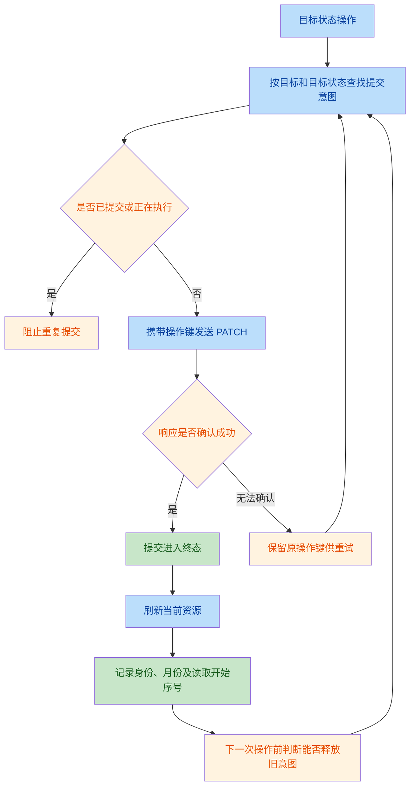
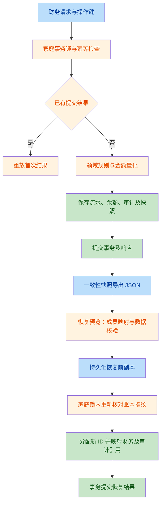

# 架构修复后再次审查

日期：2026-10-01。范围：当前工作区全部未提交和新增的架构代码，
重点复查 [F1–F5 修复记录](architecture-fixes-2026-10-01.md)。
审查结论以当前文件行为为准；HEAD 用于识别变更来源，不作为上一轮修复前的快照。

> 实施更新：下述 4 个 P2 问题已在同日全部修复并完成新一轮回归。
> 结果与当前验证数字见
> [第二轮修复与验收](architecture-fixes-2026-10-01-round-2.md)；
> 以下保留原始发现、复现证据和当时的验证结果。

## 原审查结论（现已修复）

审查当时发现 **4 个 P2 问题**，每项均经主审复现及两路独立复核确认（2/2，高置信度）。
既有回归全部通过，但未覆盖下面的组合边界。当前没有足够证据将本次改造判为
完全闭环；这些问题可在现有模块边界内修复，不需要整体重写。

| 编号 | 问题 | 建议 | 代码位置 |
| --- | --- | --- | --- |
| 1 | P2：目标完成后切月，再恢复、完成时被旧提交状态拦截 | 持久保存已接受的读取确认，在凭据替换前完成意图确认；保留未知结果的原键重试规则 | [useSubmission.js:124–127](file:///Users/bytedance/Desktop/invest-app/frontend/src/features/shared/useSubmission.js#L124-L127) |
| 2 | P2：投资账户备份省略默认字段时，预览抛异常 | 进入领域校验前统一补齐允许省略的默认字段 | [domain/accounts.py:25–28](file:///Users/bytedance/Desktop/invest-app/backend/domain/accounts.py#L25-L28) |
| 3 | P2：目标及预算审计载荷与详情组件不兼容 | 按实体结构解包目标、记录及分配，补齐预算总额比较 | [AuditDetails.jsx:59–60](file:///Users/bytedance/Desktop/invest-app/frontend/src/components/AuditDetails.jsx#L59-L60) |
| 4 | P2：转账汇率量化导致有效转账失败，或自身备份无法恢复 | 同币种保留原汇率；统一跨币种写入、存储精度和恢复校验的舍入残差规则 | [application/accounts.py:508–511](file:///Users/bytedance/Desktop/invest-app/backend/application/accounts.py#L508-L511) |

### 1. 已成功确认的目标操作在切月后再次被拦截

复现：9 月标记完成，写入及随后 GET 均成功；切到 10 月，恢复目标，
再次标记完成。预期三个 PATCH，实际只有两个，最后一次被当成重复提交。

`useCommandActions` 只在下次调用命令时检查当前凭据；切月先清掉了 9 月的
成功读取凭据，命令 Map 却不清理。目标操作键只含目标 ID 和状态，
旧 completed 意图的 `resourceKey` 仍为 `goals:2026-09`，
10 月成功读取无法再确认它。切回 9 月读取可解除，故不是永久阻塞。

这是已发生的有效确认被遗失，并非要求其他月份的读取替代当前月份确认。
验收需同时覆盖：同月循环、确认后切月、读取失败后重载、进行中请求防重。

### 2. 允许省略的投资账户字段触发备份预览 500

复现：创建投资账户并导出，原备份预览成功；仅省略账户的 `is_liability`，
再次预览抛出 `KeyError: 'is_liability'`，独立 HTTP 验证返回 500。

该列有 SQL 默认值 `0`，备份列校验允许省略；历史基线规则和前面的现金检查
也使用缺省值。最后调用 `validate_account_state` 时却直接索引该字段。
现有省略字段测试只覆盖普通账户，未进入投资账户分支。

影响范围是省略该默认字段的投资账户备份，不是所有备份。
验收应覆盖普通、投资、负债账户及旧版本备份，统一校验与落库的默认值语义。

### 3. 有明确变化的目标及预算审计被显示为空

后端目标快照是 `{goal, allocations}`，目标存取快照是
`{goal, allocation, record}`，家庭查询直接将这些载荷传给详情组件。
组件只比较顶层字段，因此目标状态 active → completed、已存金额 0 → 10
均显示“本次操作没有可展示的字段变更。”

预算快照的 `total_amount` 不在字段白名单，分类及成员分配又是嵌套结构。
独立复核使用真实后端生成的家庭审计载荷渲染，预算 100 → 200 同样无法展示。
审计数据仍然保存在后端，缺陷在详情解析和呈现。

验收应从实际财务命令产生载荷，覆盖目标状态、目标存取、预算总额与成员分配；
继续使用明确的业务字段白名单，不直接展示任意未知对象。

### 4. 转账两级舍入与历史汇率校验不一致

两个隔离 SQLite 案例均已复现：

- 同币种转账 1 KRW，账户汇率 0.0048：本位币金额舍入为 0，反推收款汇率变为 0，
  触发 `transaction_fx_positive` 数据库异常。事务完整回滚，没有部分入账。
- 转出 10,000 USD，汇率 7.1234567891，实际到账 250,000,000 VND：
  转账成功，收款腿保存汇率 `0.0002849383`、本位币金额 `71234.57`；
  按保存的金额及汇率重算为 `71234.58`。随后导出自己的账本再预览恢复，
  返回 422“流水本位币金额与历史汇率不一致”。

写入先将本位币金额舍入两位，再将反推汇率舍入十位；恢复校验要求分币相等。
在上述到账规模下，每一个汇率最小单位对应 0.025 元，不能精确表达任意一分钱。
因此仅取消提前舍入不足以解决全部场景，必须协调存储精度、历史事实和校验残差，
且不能用账户当前汇率重新估算历史转账。

验收应覆盖本位币小于半分的正金额、同币种、高计价单位跨币种、导出恢复往返、
双腿本位币守恒及异常完整回滚。

## 改造意图与调用链

本次改造保留模块化单体，将财务写入、领域规则、持久化和一致性查询分层，
统一业务时钟、提交防重、家庭恢复及版本化审计。复审既检查已修路径，
也检查页面切换、响应丢失、备份缺省字段和金额舍入等组合边界。

业务提交链路：

财务写入与恢复链路：

## 本轮重新执行的验证

| 检查 | 本轮结果 |
| --- | --- |
| 后端全量 unittest | 203 项：173 通过、30 跳过、0 失败 |
| 前端已有 Vitest | 27 个文件、153 项通过 |
| 真实 API 浏览器 | 桌面、平板、手机共 9 项通过，0 跳过 |
| 运维脚本故障注入 | 8 项通过 |
| 架构 AST 检查 | 通过 |
| 前端 lint | 0 warning、0 error |
| 生产构建与产物检查 | 通过，14 个产物文件 |
| diff 空白检查 | 通过 |

以上是本轮重新运行的结果，不沿用上一轮数字。全量 Vitest 在新增审查探针之前运行。
测试均使用隔离临时账本，真实浏览器使用专用后端、端口和数据库。
日志为 `/tmp/invest-review-oct01-{backend,frontend,real-browser,ops,lint,build}.log`。
目标跨月和审计展示的定向探针未通过，备份及转账问题由独立临时 SQLite/HTTP
场景复现；“既有测试通过”不能覆盖这些失败证据。临时探针收尾清理，
本轮仅新增本审查报告，未修改业务实现。

30 项跳过包括 29 项 PostgreSQL 工作流和 SQLite 套件中的 1 项 PostgreSQL 专属
并发测试。本机仍缺 PostgreSQL/Docker 环境；本轮未运行真实 PostgreSQL 或容器
备份恢复演练，运维脚本的模拟故障注入通过不能替代容器演练证据。
