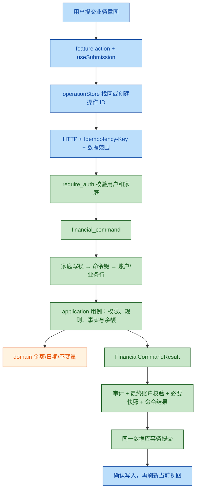
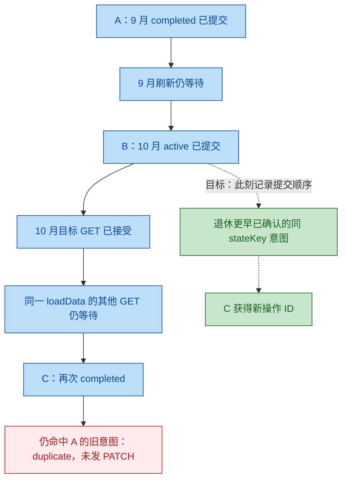

# 家庭投资与收支管理项目架构审查

审查日期：2026-10-06。审查对象是当前完整工作区，包括尚未提交的新模块；不是仅审查 Git HEAD，也不把旧报告结论作为本次验收证据。本次只审查，未修改业务实现或真实账本。

基线 HEAD：`05fe5762974168a6a91213a1b13ed63a0677db64`。对 `backend`（排除 venv）及 `frontend/src` 的 208 个 Python/JS/JSX 文件按路径排序后计算的内容摘要：`27f331003301812b0b77774f45ccac1dd64a8a574c9196fb73b8dba2a70349c3`。下文行号均指当前工作区版本。

## 1. 总体结论

| 项目 | 结论 |
|---|---|
| 架构合理度 | **基本合理** |
| 综合评分 | **78 / 100**，工程判断分，不是测试通过率 |
| 一句话结论 | 模块化单体及财务事务基础适合当前产品，主要短板集中在操作终态、诊断结果和审计载荷跨模块传递的闭环。 |
| 最突出的优点 | 资金事实、账户状态、审计、幂等记录和必要快照在同一事务内提交；历史汇率与原始财务语义有明确约束。 |
| 最大的架构风险 | 一个模块新增了状态或载荷结构，调用方、恢复方和界面没有同时升级；各自测试通过，完整流程仍出现阻断或语义失真。 |
| 是否需要立即重构 | **否**。需要尽快修复下列 P1，不需要整体重写。 |
| 判断依据 | 实际跟踪了认证、财务命令、读取事务、行情、快照、恢复、前端请求身份和提交确认；既有回归通过，但新增行为探针发现边界缺口。 |

评分考虑：架构适配 18/20、职责与依赖 11/15、财务一致性基础 16/20、可靠性与恢复闭环 13/20、测试与交付 12/15、文档与可操作性 8/10。扣分集中在下文可定位的问题，不以文件长度或未采用某种设计模式扣分。

本次未发现足以认定为 P0 的新增资金重复扣减、跨家庭财务结果泄露或整体不可启动问题。P1 是已复现的局部功能/治理缺陷，应尽快修复；不能把“未发现 P0”解释成生产安全认证。

两路独立复核对全部 7 项的存在性均确认（2/2）；最终分为 **2 项 P1、4 项 P2、1 项 P3**，其中 5 项真实问题、1 项验证风险、1 项可选维护优化。两路复核均建议对可恢复的目标阻断、保留原文的审计缺口和职责集中收紧等级，本报告已采纳。

### 本次验证事实

| 验证 | 实际结果 | 边界 |
|---|---|---|
| 后端 `python -m unittest discover -s tests -p 'test_*.py' -v` | 共 237 项，**201 通过、36 跳过、0 失败** | 跳过的真实 PostgreSQL 用例不能算通过 |
| 前端 `npm run test:coverage` | **191 项通过，29 个文件通过** | 语句 76.23%、分支 61.82%、函数 70.55%、行 79.09%；不包含浏览器覆盖率 |
| `npm run lint` | 0 错误、0 警告 | 静态规则不能证明业务流程正确 |
| `npm run verify:build` | 生产构建及 14 个产物检查通过 | 主 JS gzip 110.43 KB，图表共享 chunk gzip 98.14 KB；未测真实设备首屏性能 |
| `python architecture_check.py` | 通过 | 检查已配置的 AST 依赖/事务规则，不是所有契约都已覆盖 |
| 模拟 API Playwright | **33 通过、18 跳过** | 部分用例内部自行遍历视口，只在 desktop 项目运行；其余项目按配置跳过，不能计为通过 |
| `npm run test:e2e:real` | **15 通过、0 跳过** | 独立临时 SQLite + 真实 FastAPI + Chromium 三种视口，不是 PostgreSQL 或原生 App |
| 运维脚本测试 | **8 通过** | 故障注入测试，未运行真实 Docker 恢复演练 |
| 新增目标交错审查探针 | **1 项预期断言失败**：期望 3 次写入，实际 2 次 | 这是 R2 的复现证据；不能笼统宣布“所有验证通过” |
| 独立行为探针 | R1 两种存储版本残留；R3 错误分类；R4 展示为空且恢复降级 | R4 同时执行了临时 SQLite 的更正、导出和实际恢复 |

本机没有 `docker`、`psql`，未配置 `INVEST_TEST_POSTGRES_URL`。仓库存在 PostgreSQL CI 作业，但本次没有取得当前工作区对应的 CI 执行结果。真实 PostgreSQL 锁等待、迁移、恢复、精度边界和 Docker 演练的验收状态为**无法判断**，需要当前代码在专用 PostgreSQL 16 实例上的运行结果。

同样无法判断线上容量、实际备份异机存储、告警是否送达、恢复 RPO/RTO、iOS/Android 容器行为；需要部署监控、备份演练记录和原生设备测试。不能从配置文件存在推断这些能力已在生产启用。

## 2. 架构还原

### 2.1 实际运行形态与模块职责

当前是**模块化单体，内部按业务用例和技术职责分层，读写路径分别组织**。没有独立读库、消息系统或事件溯源；不能把 `commands/queries` 的命名直接解释成完整 CQRS。

| 核心模块 | 实际职责与证据 |
|---|---|
| Web / Capacitor | React 共享 UI；`frontend/src/main.jsx` 挂载 App，`App.jsx` 用 `lazy` 加载四个主页面，`capacitor.config.json` 使用同一 `dist`。 |
| 前端会话 | `app/useSession.js` 管理登录、scope、家庭信息和请求世代；`api.js` 为请求固化 token/scope/generation 并拒绝过期回填。 |
| 前端数据资源 | `app/useFinanceData.js` 按页面启用各 feature 的 `use*Data`，并行刷新；`useScopedDataResource.js` 生成接受读取的确认凭据。 |
| 前端业务意图 | `operations/operationStore.js` 管理持久化操作 ID；`features/shared/useSubmission.js` 管理写入和刷新；feature `actions.js` 构造业务请求。 |
| HTTP 与认证 | `backend/main.py` 装配 FastAPI、CORS、日志和路由；`routers/auth.py::require_auth` 解析身份，`application/authentication.py` 校验签名、token_version 和活跃成员关系。 |
| 业务用例 | `application/accounts.py`、`ledger.py`、`investing.py`、`budgets.py`、`goals.py` 实施权限和业务校验，显式接收事务连接。 |
| 财务事务 | `application/commands.py::financial_command` 包住路由调用，统一幂等、审计、最终账户校验和快照；用例返回 `FinancialCommandResult`。 |
| 领域规则 | `domain/money.py`、`accounting.py`、`reconciliation.py`、`dates.py`、`valuation.py` 等提供金额、日期、核对和估值纯计算。 |
| 读取模型 | `queries/finance.py`、`queries/reconciliation.py` 等组合查询；`infrastructure/read_models.py::consistent_query` 负责一致性读取。部分账本/明细查询仍在 application 中。 |
| 数据基础设施 | `infrastructure/connection.py` 适配 SQLite/psycopg；`database.py` 提供连接、锁、事务和历史 bootstrap；`accounting_store.py` 持久化余额变更；`restore_store.py` 重建恢复 ID。 |
| 外部行情 | `integrations/market_data.py` 处理供应商协议；`application/market_data.py` 先读取并释放连接，再并发取价，最后条件更新与刷新快照。 |
| 迁移与后台任务 | `migrate.py`、`migrations/schema.py` 管理 schema 11；`snapshot_scheduler.py` 调度每日快照；`jobs/financial_command_retention.py` 清理响应正文、保留去重墓碑。 |
| 恢复与运维 | `application/backup.py` 处理家庭 JSON v8 及旧格式；`deploy/scripts/postgres_backup.py` 处理整库备份、校验、镜像和隔离恢复演练。 |

生产主路径是 Docker Compose：PostgreSQL 16 → backend 健康检查 → Nginx 静态资源/API 代理。`backend/Dockerfile` 先执行 `migrate.py`，再启动单 worker Uvicorn；`main.py::lifespan` 进行安全与版本检查。Vercel 配置关闭启动迁移和进程内调度，只是 API 兼容入口；无法据此认定家庭文件恢复在实际 Vercel 环境可用。

### 2.2 财务写入调用链



证据：[财务事务执行](file:///Users/bytedance/Desktop/invest-app/backend/application/commands.py#L165-L243)、[命令结果持久化](file:///Users/bytedance/Desktop/invest-app/backend/application/commands.py#L244-L272)、[事务与家庭锁](file:///Users/bytedance/Desktop/invest-app/backend/infrastructure/database.py#L73-L130)、[流水路由与用例连接](file:///Users/bytedance/Desktop/invest-app/backend/routers/transactions.py#L115-L165)。

PostgreSQL 用家庭事务 advisory lock 串行化同家庭写入，不同家庭使用不同锁；SQLite 使用 `BEGIN IMMEDIATE`，写入串行范围更大。读取采用 PostgreSQL `REPEATABLE READ READ ONLY` / SQLite `BEGIN`；子查询显式复用连接。该保证作用于**一次响应内部**，没有多次 HTTP 请求的统一快照版本。

### 2.3 财务模型与状态归属

- `transactions` 保存收支、期初、调整、转账双腿；`investment_trades` 保存买卖与结算。它们是业务事实。
- `accounts.balance/cash_available` 与 `holdings` 保存当前状态；命令联动更新，投资现金和持仓市值各有语义。
- `snapshots` 是按日估值派生数据；目标进度与预算分配不代表冻结或增加资产。
- 流水原币、历史汇率和本位币金额固化；`application/ledger.py::updated_transaction_money` 在非金额编辑时保留原汇率。
- 浏览器服务端数据属于 feature resource；草稿属于 workspace/dialog；operation ID 属于可跨刷新恢复的业务意图。`ContextVar` 属于请求/命令上下文，不是任意用户共用的可变业务状态。

数据库模型仍通过字典和 Pydantic 请求模型进入 application，备份也参考数据库列。当前规模下无需强制引入完整实体模型和通用仓储；真正需要收紧的是已出现的跨模块协议缺口。

### 2.4 依赖、性能、安全和工程边界

| 检查面 | 基于代码的判断 |
|---|---|
| 依赖方向与循环 | 本次 AST 检查未发现其规则覆盖范围内的循环或反向 router 导入。domain 保持纯规则；application 直接依赖 FastAPI 异常、Pydantic 和部分 Response，说明不是完全框架无关的用例层。对于当前单一 HTTP 产品，这不构成立即重构理由。 |
| 第三方依赖 | `frontend/package.json` 中 React/Recharts/PapaParse/Capacitor 分别服务 UI、图表、账单解析和原生壳；`backend/requirements.txt` 的 FastAPI/Pydantic/psycopg/requests 服务协议、校验、驱动和行情。没有发现必须新增第三方组件才能解决的问题。未做供应链漏洞专审。 |
| 公共能力与领域能力 | 金额、日期、不变量位于 domain；数据库驱动、文件备份、行情供应商有各自入口。顶层 `database.py/commands.py/services.py` 等是兼容导出，不能当作重复业务实现。 |
| 性能与并发 | 家庭写锁换取明确一致性，符合低写并发场景；`connection.py::open_connection` 每次建连接，`useFinanceData` 可见页面每 30 秒刷新，快照随资金命令同步更新。高连接数/锁等待是否已成瓶颈无法判断，需要请求量与 P95。现在不建议先上缓存或异步资金写入。 |
| 故障隔离 | 行情先释放读取连接再取价；后台任务有状态记录；命令失败回滚相关财务事实。快照仍属于财务命令的成功条件，这是当前有意的一致性选择；拆为异步前必须定义允许的延迟和补偿规则。 |
| 安全与敏感数据 | `security.py` 要求生产独立强口令/签名密钥，PBKDF2 存储密码；`require_auth` 校验当前活跃成员与 token_version；Nginx 有登录限流及 CSP。operation 存储不保存财务正文/令牌，但会话令牌本身在 localStorage，依赖前端脚本与源隔离；本次未发现可证实的新越权链路，也未验证线上配置。 |
| 可观测性 | `main.py::request_observability` 记录 request ID、路径、状态、时延；`/livez`、`/healthz` 与后台任务表有不同职责；备份脚本记录校验和与最近成功时间。仓库只提供监测入口，通知接收方与告警是否部署无法判断。 |
| 构建、协作和发布 | 前端有 lockfile、lint、构建产物检查和懒加载；后端依赖限定版本区间但无完全锁定文件。前后端可分别构建，涉及协议/迁移时仍需协调发布。现有 README、架构文档、ADR 和部署说明已足够起步，历次报告不能代替当前执行证据。 |

## 3. 做得合理的地方

| 架构点 | 具体证据 | 带来的价值 |
|---|---|---|
| 保持单体与显式装配 | [main.py](file:///Users/bytedance/Desktop/invest-app/backend/main.py#L112-L123)、[Compose](file:///Users/bytedance/Desktop/invest-app/docker-compose.yml#L10-L86) | 适合家庭财务规模，不引入分布式事务、队列或缓存一致性负担。 |
| 统一财务事务和锁顺序 | [commands.py](file:///Users/bytedance/Desktop/invest-app/backend/application/commands.py#L165-L243)、[database.py](file:///Users/bytedance/Desktop/invest-app/backend/infrastructure/database.py#L73-L130) | 同一次写入的余额、事实、审计与快照可整体回滚。 |
| 显式审计与影响集合 | [FinancialCommandResult](file:///Users/bytedance/Desktop/invest-app/backend/application/commands.py#L115-L148) | 不再依赖函数名猜审计，能够局部校验账户和刷新成员快照。 |
| 领域计算不依赖数据库/HTTP | `domain/accounting.py`、`domain/money.py`；[架构守卫](file:///Users/bytedance/Desktop/invest-app/backend/architecture_check.py#L99-L155) | 金额及不变量可脱离数据库测试；本次 AST 检查通过。 |
| 历史日期和核对结论分离 | [reconciliation.py](file:///Users/bytedance/Desktop/invest-app/backend/domain/reconciliation.py#L12-L61)、[查询结论](file:///Users/bytedance/Desktop/invest-app/backend/queries/reconciliation.py#L68-L111) | 期初证据、应用语义和余额求和不会再被一个 `matches` 混淆；后端已能诊断漏扣。 |
| 一次响应内一致性读取 | [consistent_query](file:///Users/bytedance/Desktop/invest-app/backend/infrastructure/read_models.py#L9-L26)、`tests/test_cross_workflows.py` 的读取/写入交错用例 | 避免组合汇总同时包含交易前现金与交易后持仓。 |
| 权限与范围明确 | [tenancy.py](file:///Users/bytedance/Desktop/invest-app/backend/tenancy.py#L89-L144)、[require_auth](file:///Users/bytedance/Desktop/invest-app/backend/routers/auth.py#L74-L96) | 家庭隔离、个人范围、管理员权限和成员归属有可跟踪入口。 |
| 恢复采用准备/提交两阶段 | [prepare_family_restore](file:///Users/bytedance/Desktop/invest-app/backend/application/backup.py#L835-L860)、[restore](file:///Users/bytedance/Desktop/invest-app/backend/application/backup.py#L863-L915) | 文件持久化在家庭锁外，锁内复核指纹；只替换当前家庭，不重置全局 ID 序列。 |
| 行情不占着数据库等待网络 | [market_data.py](file:///Users/bytedance/Desktop/invest-app/backend/application/market_data.py#L24-L43)、`test_quote_fetch_releases_read_connection_before_network_io` | 外部供应商迟缓不直接延长家庭财务写事务。 |
| 幂等结果保留墓碑 | [重放规则](file:///Users/bytedance/Desktop/invest-app/backend/application/commands.py#L34-L68)、`jobs/financial_command_retention.py` | 结果正文过期或恢复后，旧键不会重新执行资金动作。 |
| 前端已按 feature 逐步拆分 | `app/useSession.js`、`useFinanceData.js`、feature actions/drafts/presentation；[App 页面懒加载](file:///Users/bytedance/Desktop/invest-app/frontend/src/App.jsx#L78-L84) | 身份、数据和业务请求已从根组件分离，有继续渐进演进的基础。 |
| 测试与部署有实际约束 | `.github/workflows/ci.yml`、`frontend/scripts/real-api-e2e.mjs`、`deploy/tests/test_postgres_backup.py` | 有跨流程回归、隔离真实 API 浏览器、构建检查和备份故障注入，不只是静态单测。 |

## 4. 问题与风险清单

按本次影响范围排序；同时注明“真实问题”“潜在风险”和“可选优化”。R2 的操作阻断可随刷新结束或重载恢复，R4 保留了原始审计值，因此均按 P2 处理；R6 尚无证据要求立即拆分，列为 P3。

| 优先级 | 问题 | 具体证据 | 影响 | 建议方案 | 改造成本 |
|---|---|---|---|---|---|
| **P1 · R1 · 真实问题** | 已确认的持久化操作无法正常退休 | [调用仍传 ID](file:///Users/bytedance/Desktop/invest-app/frontend/src/operations/operationStore.js#L298-L303)，[被调函数要求对象](file:///Users/bytedance/Desktop/invest-app/frontend/src/operations/operationStore.js#L112-L119) | v1/v2 committed/invalidated 记录残留；新开相同内容表单仍恢复旧键，被当成已处理/失效而不能提交。 | 修复对象参数；围绕“确认终态→明确新意图→新键”补行为测试，未知结果继续保留原键。 | 低，0.5–1 人日 |
| **P1 · R3 · 真实问题** | 历史漏扣诊断没有贯通用户界面 | [仅凭标记判历史补录](file:///Users/bytedance/Desktop/invest-app/frontend/src/features/ledger/presentation.js#L55-L63)，[无条件解释为不影响余额](file:///Users/bytedance/Desktop/invest-app/frontend/src/features/ledger/presentation.js#L85-L115)；前端未调用核对接口 | 建账后的漏扣在列表中仍被解释成正常历史补录。后端诊断正确，但持有人看不到区分和逐笔更正入口。 | 用服务端应用语义作为展示依据；接入只读核对和受控更正，不自动调余额；迁移后输出明确核对指引。 | 中，2–3 人日 |
| **P2 · R2 · 真实问题** | 新状态的退休逻辑仍等待整组刷新完成 | [await 后才 supersede](file:///Users/bytedance/Desktop/invest-app/frontend/src/features/shared/useSubmission.js#L175-L186)，[写成功后继续等待刷新](file:///Users/bytedance/Desktop/invest-app/frontend/src/features/shared/useSubmission.js#L69-L87) | 目标已完成→恢复后，相关目标 GET 成功但其他 GET 挂起时，第三次完成被旧意图吞掉。 | 在确认写入的时刻更新同身份/stateKey 的提交顺序并退休旧终态；资源读取确认保持独立。 | 中，1–2 人日 |
| **P2 · R4 · 真实问题** | 新更正审计结构未登记到展示与恢复契约 | [写嵌套载荷](file:///Users/bytedance/Desktop/invest-app/backend/application/ledger.py#L964-L982)，[未注册结构降为 historical](file:///Users/bytedance/Desktop/invest-app/backend/domain/audit_payloads.py#L62-L78)，[前端无 transaction 嵌套分支](file:///Users/bytedance/Desktop/invest-app/frontend/src/features/audit/presentation.js#L153-L165) | 更正 100→90、标记 0→1 却显示无可展示变更；恢复后新审计被当作旧载荷，失去当前实体的结构化关联。原始值仍保留。 | 增加明确交易应用更正载荷契约与展示字段；覆盖创建→展示→导出→恢复→再次展示。 | 中，1–2 人日 |
| **P2 · R5 · 真实问题** | 恢复预览隐藏快照择一保留的具体结果 | [弹窗只显示计数/成员](file:///Users/bytedance/Desktop/invest-app/frontend/src/components/BackupDialog.jsx#L86-L110)，[后端已返回兼容报告](file:///Users/bytedance/Desktop/invest-app/backend/application/backup.py#L923-L942) | 用户确认时看不到保留/舍弃的快照 ID、日期、原因。算法确定性和原备份保留不等于确认信息完整。 | 展示 `snapshot_compatibility.collisions`；有碰撞时把这些明细纳入当前确认内容。 | 低，0.5–1 人日 |
| **P2 · R7 · 潜在验证风险** | 最新关键升级案例未进入真实 PostgreSQL 共享矩阵 | [SQLite 更正用例](file:///Users/bytedance/Desktop/invest-app/backend/tests/test_integrity_regressions.py#L1041-L1138)、[PG 继承集合](file:///Users/bytedance/Desktop/invest-app/backend/tests/test_cross_workflows.py#L609-L653)、`test_architecture_regressions.py` 日期迁移夹具 | 配置了 PostgreSQL CI 也不会自动在 PG 重跑这些 SQLite 专属用例；升级、锁和回滚的生产证据不足。 | 将协议升级/历史更正场景提成共享 mixin；增加 PG 迁移夹具与屏障并发，CI 保留当前代码的成功证据。 | 中，2–3 人日及测试实例 |
| **P3 · R6 · 可选优化** | 部分功能仍须跨根组件、查询和协议代码协同修改 | [App 删除动作分派](file:///Users/bytedance/Desktop/invest-app/frontend/src/App.jsx#L823-L863)、[页面大接口](file:///Users/bytedance/Desktop/invest-app/frontend/src/App.jsx#L939-L990)、`application/ledger.py::query_ledger/export_ledger/create_transaction` | 新动作需在 App 同步标签、动作映射和确认资源键；读取与写入仍在部分模块共处。但恢复/跨域报表的集中编排有合理性，不等于万能模块。 | 触及功能时提取页面 controller 和对应 query；以实际修改频率决定，不全面改造 repository/DTO。 | 渐进，3–5 人日，非立即必做 |

R7 限定为列出的升级场景：现有 PostgreSQL 共享 `HistoryWorkflows` 已包含旧备份日期规范化、快照碰撞等测试；并非“PostgreSQL 完全没有覆盖”。

## 5. 重点问题深入分析

### R1：终态操作清理接口发生漂移

1. **当前实现。** `removeStoredOperation(operation)` 使用对象中的 `storageVersion/id` 选择并删除记录；`acknowledgeOperation` 仍传字符串 ID。
2. **问题原因。** 字符串上的 `storageVersion`、`id` 都是 undefined：代码默认处理 v2，却没有任何条目 ID 与 undefined 相等。v1 条目没有被处理，v2 条目也未被删除。这里没有类型检查或测试及时发现调用契约变化。
3. **触发场景。** 响应丢失后原键得到 committed 收据、响应过期，或账本恢复导致 invalidated。页面确认并新开相同内容表单；`resolveOperation` 从存储再捞到旧键。探针对 v1、v2 都得到 `sameKey=true, nextStatus=committed`。正常立即成功路径走 `markOperation(...,"succeeded")`，不能用该路径证明恢复路径正常。
4. **推荐目标结构。** operationStore 是内存和持久化条目的唯一生命周期所有者；终态确认与新的业务意图是明确事件。
5. **最小方案。** 调用传完整 operation 对象；测试 v1/v2 与 committed/invalidated 四种组合。只退休已经确认的终态条目。
6. **完整方案。** 给 `Operation` 增加 JSDoc/类型约束，收敛 `mark/acknowledge/retire` 的前置条件；未知范围操作仍保留原 ID，继续服务端核对。无需整体迁移 TypeScript。
7. **风险与验证。** 错把 unknown 当终态清理会重新引入重复记账。必须验证同一未知意图重试仍用原键、跨身份不收养、主动“再记一笔”才生成新键、浏览器刷新后不会复活已确认条目。

### R2：状态替代事件仍依赖无关 GET

1. **当前实现。** `executeSubmission` 已区分 `writePending/refreshPending`；`GoalsPage` 在 PATCH 确认时释放按钮。但 `useCommandActions` 要等整个 `executeSubmission` 返回才调用 `supersedeStateIntents`。
2. **问题原因。** `useFinanceData::loadData` 是多个资源 `Promise.all`。目标 GET 成功并不代表整个刷新结束；`consumeConfirmations` 可以先删除 B 自己，却没有替代 A 的证据。旧 A 仍占据同一 `goal:id:completed` 键。
3. **触发场景。** A：9 月完成成功，9 月 GET 延迟；切到 10 月；B：恢复 active 成功，10 月目标 GET 已接受，但同期其他数据 GET 未结束；C：用户在已显示 active 的列表再次完成。探针得到：

   ```text
   expectedWrites: 3
   actualWrites: 2
   third: { committed: true, duplicate: true }
   ```

   原有浏览器用例把第二次刷新完成后再第三次提交，因此 15 项通过不能排除此交错。这里证明的是合法状态操作被阻断，没有证明重复扣款。
4. **推荐目标结构。** “服务端确认写入”独立更新每个身份/stateKey 的最新提交序号；“资源读取被接受”只控制视图与该资源确认。两者不等待对方，也不共享一个 Promise 结束时点。
5. **最小方案。** `executeSubmission` 在设置 committed/settledAt 后触发内部确认回调，先退休同 stateKey 的更早已确认终态，再执行 UI 回调与刷新；保留当前身份、generation 和操作实例校验。
6. **完整方案。** 抽出小型、可纯函数测试的状态转换逻辑，保存最新提交序号；Map 的删除按意图实例而不是只有字符串 key。无需引入全局状态框架。
7. **风险与验证。** 保留未知写入、处理中写入、跨身份及预算按月确认。覆盖两个 GET 的不同完成顺序、其他资源永久延迟、PATCH 未确认、切月/切 scope、双击和原键重试；增加真实浏览器“目标 GET 已成功而另一 GET 延迟”的案例。

下面显示已复现的交错及最小修复位置。



### R3：应用标记的业务语义没有进入展示协议

1. **当前实现。** 后端 `transaction_application_diagnostics` 已比较发生日、建账日、source 和撤销状态，查询返回 `healthy/application/history`。前端只看到 `balance_applied=0` 就输出“历史补录”与“不影响当前账户余额”，没有消费核对结果。
2. **问题原因。** 实际是否应用的存储标记，被展示层当成“业务上应当不应用”的证明。存量错误正好使这两者不一致。schema 11 的函数处理快照和命令协议元数据，并不执行或输出应用标记诊断；`migrate.py` 只输出版本就绪。
3. **触发场景。** 9 月 1 日建账 100 元，9 月 28 日支出 10 元但旧标记为 0。临时 SQLite 返回 `actual=100, matches=true, healthy=false, application=inconsistent`；相同流水传入当前展示函数仍返回 `statusLabel=历史补录`。这不是后端核对计算仍出错，而是界面没有呈现异常。
4. **推荐目标结构。** 服务端给出明确的应用语义/限制；列表只显示该语义，账户核对页展示诊断明细。财务状态修复独立于诊断读取。
5. **最小方案。** 在账户详情增加只读核对入口，展示账户、流水、发生日、实际/预期标记和差额；未取得证据时用中性“未应用到账户余额”，不能断言是合法历史补录。
6. **完整方案。** 共享领域诊断供列表读模型、核对 API、备份预览和迁移后报告使用；从异常明细发起已有受控更正接口，提交原余额、标记、原因和操作 ID。不要在读取、升级或打开弹窗时自动翻标记或追加 adjustment。
7. **风险与验证。** 真正建账前补录仍不影响当前余额，撤销流水不再扣一次，负债账户符号和投资现金字段保持正确。校验诊断只读、更正一次、失败回滚、权限隔离和更正后导出恢复。历史不足仍显示限制，不把差额为零当成健康。

### R4：更正审计生产方与消费方使用不同结构

1. **当前实现。** 更正用例写入 `{transaction: 原/新流水, account: 原/新账户}`，实体类型仍为 transaction、载荷版本 1。恢复映射只为目标、预算、投资交易等登记嵌套形状；前端 transaction 走通用平面行处理，字段表也没有 `balance_applied`。
2. **问题原因。** 新业务用例新增载荷，没有同步结构契约、展示映射和往返验收。版本字段存在，但没有保证“这一版本支持哪些结构”。
3. **触发场景。** 更正账户 100→90、流水标记 0→1；`auditFieldChanges` 返回 `changes=[]`。实际临时 SQLite 恢复把账户 1 映射为 2、流水 2 映射为 4；审计 entity_id 正确变为 4，但正文被整体包装为 historical，里面保留旧 ID。**原始载荷没有丢失，也没有被错误绑定到别家账户**，缺陷是新操作不能结构化展示/关联。
4. **推荐目标结构。** 更正审计使用登记过的具名结构，生产、恢复和展示消费同一版本定义，未知载荷才保守降级。
5. **最小方案。** 登记 transactions 的 transaction/account 子行；前端增加对应行分组、余额字段和应用标记标签；保留普通平面 transaction 载荷兼容。
6. **完整方案。** 给审计形状建立精简的 schema/fixture 清单，以每类真实命令生成的记录运行展示与恢复往返测试。已有 historical 包装的解读只能针对确证结构另行处理，不自动猜测所有旧 ID。
7. **风险与验证。** 新结构登记可能误解释旧普通流水或未知 JSON。覆盖更正前后、负债/投资现金、同家庭/跨家庭/再次恢复、被删除实体及未知版本；核对金额、实体映射和页面字段，不能只断言审计条数。

## 6. 推荐的目标架构

保留现有单体、数据库及 HTTP 路由。目标是让**状态转换和财务语义有唯一来源，页面、备份和审计明确消费这些契约**。

### 6.1 依赖与接口边界

- 路由负责 HTTP 输入、身份及响应；财务装饰器仍持有外层事务。用例继续接收 `conn/context`，返回显式响应、影响集合和审计事实。
- domain 保持纯规则；查询可以直接使用 SQL 并调用 domain，不强制绕过一层通用 repository。
- 将被频繁修改的读取移到对应 `queries/*`；CSV 编码/HTTP Response 放在导出适配处。application 中其他稳定查询可随功能迭代迁移。
- 保留 `FinancialCommandResult`；增加明确的 `ReconciliationResult` 和审计形状约定，覆盖账户字段、历史证明、应用语义、余额差异及限制。
- 操作协议明确 `writeConfirmed`、`readConfirmed`、`acknowledged` 的意义。未知结果不得通过开新键解决；新状态的替代不能等待无关刷新。
- 备份预览必须呈现实际会发生的映射、兼容转换和阻断理由，持有人确认后才执行现有恢复命令。
- 对外稳定接口不要依赖重命名 Python 函数。当前命令指纹包含模块名/函数名（`commands.py::command_fingerprint`），以后移动受装饰入口时应保留兼容身份或版本；现在无需为此另建插件框架。

### 6.2 数据流与状态流

写入：页面意图 → operation ID → 身份/范围校验 → 单一财务事务 → 已确认提交事件 → 可独立进行的资源刷新。

读取：明确身份和查询参数 → 一致性读取 → 带业务语义的读模型 → feature presentation → UI；只有当前身份、当前资源且在写入之后发起的成功读取可以成为确认依据。

历史治理：只读诊断 → 持有人核对原事实 → 受控更正 → 审计展示 → 导出/恢复往返。恢复和审计不是独立于财务业务的附属功能，必须参与同一契约验收。

### 6.3 推荐目录结构

以下为渐进目标；标注“按需”的目录不要求立即建立。

```text
backend/
├── main.py                         # 进程启动与装配
├── routers/                        # HTTP 输入、身份、响应
├── application/
│   ├── commands.py                 # 现有统一财务事务
│   ├── accounts.py / ledger.py      # 账户、记账、更正用例
│   ├── investing.py                # 投资结算与撤销
│   ├── budgets.py / goals.py
│   ├── backup.py                   # 保留恢复编排
│   └── snapshots.py
├── domain/
│   ├── money.py / dates.py
│   ├── accounting.py / reconciliation.py
│   ├── audit_payloads.py           # 已登记载荷与兼容规则
│   └── snapshot_compatibility.py
├── queries/
│   ├── ledger.py                   # 按需迁入联合账本读取
│   ├── accounts.py / investments.py # 按需拆分既有 finance
│   ├── plans.py                    # 按需拆分预算/目标读取
│   ├── reconciliation.py / commands.py
│   └── finance.py                  # 过渡期稳定导出
├── infrastructure/
│   ├── connection.py / database.py
│   ├── accounting_store.py / restore_store.py
│   ├── read_models.py
│   └── recovery_files.py           # 按需提取文件持久化
├── integrations/                  # 行情供应商
├── migrations/                    # 只追加新迁移
├── jobs/                          # 快照/保留/只读诊断命令
└── tests/
    ├── test_domain_rules.py
    ├── upgrade_cases.py            # 新增：双数据库共享升级场景
    ├── history_cases.py / restore_cases.py
    └── test_cross_workflows.py

frontend/src/
├── App.jsx                        # 导航、会话与页面装配
├── app/                           # session、跨功能工作区
├── operations/
│   ├── operationStore.js          # 持久化身份及兼容
│   └── lifecycle.js               # 按需：纯状态转换，不分派业务
├── features/
│   ├── accounts/                  # 详情、只读核对、更正入口
│   ├── ledger/                    # 流水语义展示、记账、导入
│   ├── audit/                     # 具名载荷展示
│   ├── backup/                    # 兼容转换预览
│   ├── goals/ / budget/ / investments/
│   └── shared/                    # 提交、资源确认
├── pages/                         # 各页面及局部 controller
├── components/                    # 纯 UI 共用控件
└── shared/                        # 日期、金额、文字显示
```

不为了目录树移动稳定代码。优先修 R1–R4 后，再以一个功能为单位调整边界。`infrastructure/database.py` 的大部分体积是冻结的历史 bootstrap，应与业务万能模块区别看待；先保证历史迁移不变，不主动重写已应用迁移。

## 7. 分阶段改造计划

工作量是熟悉项目的单人有效开发时间，含针对性测试，不含外部环境等待；存在重叠，不宜机械相加为交付承诺。

### 第一阶段：低风险、高收益，可以立即实施

| 改动范围 | 预期收益 | 风险 | 验证方法 | 大致工作量 |
|---|---|---|---|---|
| R1：终态清理调用与行为测试 | 已确认意图可以结束，新表单正常获得新键 | 误清 unknown 引发重复提交 | v1/v2 × committed/invalidated；未知状态、身份隔离、重载后新意图 | 0.5–1 人日 |
| R3 最小止损：把未经证实的“历史补录”改成中性标记，提供只读核对指引 | 不再把漏扣解释成合法业务 | 文案替换掩盖详细异常 | 异常夹具与真正建账前记录分别断言，不改变资金 | 0.5 人日，包含在 R3 总量内 |
| R5：备份预览展示兼容明细 | 用户可审核实际择一保留结果 | 界面明细与服务端预览不一致 | 混合日期碰撞、无碰撞、不同成员；三种视口确认内容 | 0.5–1 人日 |
| R7：准备隔离 PG 运行并固化当前基线结果 | 把跳过项变成真实证据 | 测试配置指错环境 | 仅使用专用可建库账号；自动临时建库/清理，保存日志 | 0.5 人日，不含实例准备 |

### 第二阶段：解决核心耦合与边界问题

| 改动范围 | 预期收益 | 风险 | 验证方法 | 大致工作量 |
|---|---|---|---|---|
| R2：写确认即时推进 stateKey 顺序 | 状态动作不受无关 GET 延迟阻断 | 清除尚未确认写入、旧回调删掉新意图 | 可控延迟矩阵 + 新浏览器场景，保留预算按月确认 | 1–2 人日 |
| R4：更正审计契约、恢复映射与 UI | 资金更正全过程可追溯 | 旧格式映射错误 | 真实更正生成审计，双数据库导出恢复往返与组件展示 | 1–2 人日 |
| R3：诊断读模型、账户核对及更正入口 | 区分合法历史补录与漏扣，持有人能够处理异常 | 错误诊断诱导资金更正 | 前/同/后建账日、撤销、负债、投资现金、权限与回滚 | 2–3 人日 |
| R7：升级案例迁入双数据库矩阵 | 覆盖 PG 的锁、迁移及旧协议差异 | 夹具准备误破坏现有测试隔离 | 旧快照/旧命令/历史漏扣夹具，事务屏障和一次性资金/审计断言 | 2–3 人日 |

### 第三阶段：长期演进与工程治理

| 改动范围 | 预期收益 | 风险 | 验证方法 | 大致工作量 |
|---|---|---|---|---|
| R6：按修改频率提取页面 controller、账本 query 和文件存储适配 | 新功能主要落在所属 feature，减少装配处修改 | 纯移动扩大 diff，破坏兼容导入/指纹 | 每次只迁一个功能，保留原路径导出和行为回归 | 3–5 人日，分散于迭代 |
| 建立协议场景矩阵与发布证据索引 | 新状态/字段同时覆盖生产、读取、审计、恢复 | 清单沦为文本不执行 | 每个场景对应可执行测试；CI 区分通过/跳过/未运行 | 1–2 人日 |
| 线上容量及运维验收 | 用真实数据判断连接池、索引、拆任务必要性 | 未测量即加复杂组件 | 记录请求 P95、DB 连接数、家庭写锁等待、备份年龄、恢复演练 | 1–2 人日建立基线，持续维护 |
| 文档整理 | 架构现状与历次修复不再冲突 | 删除有价值历史决定 | 以 architecture.md/ADR 为当前约定，旧轮次报告标明仅历史证据 | 0.5–1 人日 |

兼容原则：保留旧操作 ID 与服务端墓碑，已应用 schema 不原地改写；任何新增数据修正流程必须有原记录引用、预期值、幂等与审计。回退客户端不能靠清空存储；回退数据库使用验证过的备份和停写流程。财务异常记录必须由账本持有人逐笔确认，本次审查没有执行任何真实更正。

## 8. 最终建议

**未来 6～12 个月能否继续支撑？** 对继续增加家庭财务功能、报表和少量成员协作，结构上可以，条件是先关闭上述 P1，并取得 PostgreSQL 验收证据。用户数、账本量和并发目标未提供，无法承诺具体容量或 SLA。当前无需更换数据库、改微服务或上消息队列。

**最优先三件事：**

1. 修复操作生命周期：R1 的终态清理和 R2 的提交顺序，恢复正常重试与连续状态操作。
2. 完成历史治理闭环：R3 的准确诊断展示与人工更正，连同 R4 的审计/恢复契约；不能只修字段或按钮。
3. 将上述场景放入真实 PostgreSQL 与浏览器的组合验收，补上 R7，并把 R5 的恢复影响展示纳入测试。

**保持不动：** 模块化单体、家庭写锁与单事务、Decimal/历史汇率、投资现金独立语义、真实建账前补录规则、一致性读取、恢复前副本及 ID 映射、纯 domain、四个主页面与现有视觉规范。

**现在不必做：** 微服务、事件总线、Redis 缓存、读写分库、通用 repository/DI 框架、全量 DTO 重建、强制全项目 TypeScript、一次性改完所有大文件、没有测量依据的连接池或大规模索引调整。这些都不是 R1–R5 的必要解法。

**如果只能做一次架构优化：** 优先统一“业务操作从提交到确认、展示、审计、恢复”的契约和可执行流程测试。R1 是清理接口漂移，R2 是提交/刷新时点混用，R3 是存储标记被误当业务语义，R4 是载荷生产与消费不一致；它们有共同成因。先把这些边界变成可验证约定，比再次搬动目录更能改善资金系统的可靠性。
