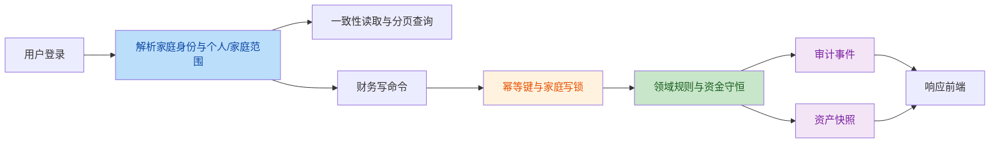
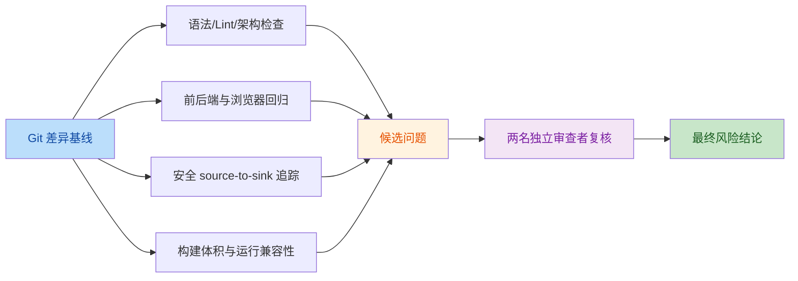

# Invest 全量未提交改动代码审计

- 审计日期：2026-10-01
- 对比基线：`HEAD 05fe5762974168a6a91213a1b13ed63a0677db64`
- 审计范围：当前工作区全部未提交、未跟踪源码与配置
- 规模：61 个已跟踪文件变更，12,739 行新增、9,722 行删除；205 个未跟踪文件
- 技术栈：FastAPI、React 19、Vite、SQLite/PostgreSQL、Docker/Nginx

## 结论

本次改动完成了领域分层、家庭租户隔离、财务命令幂等、历史汇率与日期契约、
备份恢复、审计日志、响应式界面及自动化验证体系等系统性改造。

第一轮审计发现的 2 个问题现均已修复：

- 高风险授权缺陷：已建立创建者、管理员和普通成员的分级凭据管理边界。
- 低风险功能缺陷：未知或归档账户的账本操作能力已改为默认拒绝。

修复后复审又发现 7 个确定问题：2 个高风险、4 个中风险、1 个低风险。其中 6 个由
本次改造引入或形成新的失败链路，另有 1 个账户账实不符校验缺口在基线版本已存在。
本轮已系统性修复全部 7 项，并补齐 WAL、恢复约束、账实一致性、跨范围幂等、权限矩阵、
提交终态和组合刷新回归。当前未发现仍由本次改动引入的发布阻断问题。

## 变更意图





## 审计发现

| # | 类别 | 问题 | 风险 | 置信度 | 证据（来源 → 危险操作/失败边界） | 改进建议 | 位置 |
|---|---|---|---|---|---|---|---|
| 1 | authorization_bypass | 家庭管理员可重置创建者或其他管理员密码并接管账号 | HIGH · 已修复 | 0.98 | 已认证 `admin` 调用 `PATCH /family/members/{owner_id}` 并提交 `password` → 原逻辑直接覆盖目标凭据；修复后仅 owner 可管理非 owner 的凭据与角色，admin 不能管理 owner/同级 admin 或修改任何成员凭据，本人改密必须校验当前密码 | 已实现分级授权并增加账号接管、越权新增管理员和本人绕过当前密码的拒绝测试 | [`backend/application/family.py:L123-L241`](file:///Users/bytedance/Desktop/invest-app/backend/application/family.py#L123-L241) |
| 2 | functional_consistency | 归档账户流水被误判为可编辑，转账被误判为可撤销 | LOW · 已修复 | 0.95 | 账户概览只返回 `is_active = 1` → 原 `canEditAccount` 对找不到的账户返回 `true`；修复后未知账户默认返回 `false`，活动且明确可编辑的账户才显示操作 | 已实现默认拒绝并补充组件、单元及三视口浏览器回归 | [`frontend/src/pages/LedgerPage.jsx:L283-L285`](file:///Users/bytedance/Desktop/invest-app/frontend/src/pages/LedgerPage.jsx#L283-L285) |
| 3 | data_migration | SQLite WAL 中的已提交数据可能在 PostgreSQL 迁移时静默丢失 | HIGH · 已修复 | 0.99 | 源库处于 WAL 模式且已提交页尚未 checkpoint → 原 `copy2` 只复制主库文件；现改用 SQLite Online Backup API 生成事务一致副本 | 已增加 WAL 未 checkpoint 回归，验证副本包含 WAL 中已提交记录且不修改源库 | [`backend/migrate_sqlite_to_postgres.py:L29-L39`](file:///Users/bytedance/Desktop/invest-app/backend/migrate_sqlite_to_postgres.py#L29-L39) |
| 4 | financial_integrity | 恢复校验允许账户余额与可重建流水不一致 | HIGH · 已修复 | 0.99 | 备份保留有效期初流水 100，但将 `accounts.balance` 改为 999；现由查询与恢复共同复用领域重建函数，比对流水、投资结算与持久化余额 | `history_basis != unknown` 的普通/投资账户账实不符会在预览阶段返回 422 | [`backend/application/backup.py:L619-L646`](file:///Users/bytedance/Desktop/invest-app/backend/application/backup.py#L619-L646)、[`backend/domain/reconciliation.py:L53-L88`](file:///Users/bytedance/Desktop/invest-app/backend/domain/reconciliation.py#L53-L88) |
| 5 | restore_validation | 预览未覆盖数据库 CHECK，恢复阶段才失败并遗留恢复副本 | MEDIUM · 已修复 | 0.98 | 预览现统一调用持久化领域约束，覆盖账户、流水、持仓、交易、预算和目标 CHECK；命令边界仅在新事务提交后消费准备产物 | 负持仓预览直接拒绝；插入失败、指纹冲突和同键重放均清理未消费恢复副本 | [`backend/application/backup.py:L606-L614`](file:///Users/bytedance/Desktop/invest-app/backend/application/backup.py#L606-L614)、[`backend/application/commands.py:L113-L226`](file:///Users/bytedance/Desktop/invest-app/backend/application/commands.py#L113-L226) |
| 6 | idempotency | 财务命令指纹遗漏 personal/family 数据范围，可能跨范围错误重放 | MEDIUM · 已修复 | 0.99 | 服务端指纹现包含 `context.scope`，客户端 operation identity 同时包含用户、家庭和范围 | 同范围未知结果仍复用原键；跨范围相同载荷生成新键，强制复用旧键则返回内容冲突 | [`backend/application/commands.py:L247-L263`](file:///Users/bytedance/Desktop/invest-app/backend/application/commands.py#L247-L263)、[`frontend/src/operations/operationStore.js:L82-L101`](file:///Users/bytedance/Desktop/invest-app/frontend/src/operations/operationStore.js#L82-L101) |
| 7 | authorization_consistency | 普通管理员仍可移除无业务记录的同级管理员 | MEDIUM · 已修复 | 0.99 | 删除与资料更新现复用同一高权限成员管理规则；admin 不能管理 owner 或同级 admin | 已增加 admin A 移除 admin B 被拒绝、token 仍有效及 owner 可移除的完整回归 | [`backend/application/family.py:L194-L220`](file:///Users/bytedance/Desktop/invest-app/backend/application/family.py#L194-L220)、[`backend/application/family.py:L369-L386`](file:///Users/bytedance/Desktop/invest-app/backend/application/family.py#L369-L386) |
| 8 | commit_state | 家庭写入成功后刷新失败会被误报为保存失败 | MEDIUM · 已修复 | 0.97 | 家庭弹窗现先确认写入、立即清理表单/编辑态，再通过共享 `refreshAfterCommit` 执行刷新 | 刷新失败只提示“已保存，数据刷新失败”，同一表单不会再次提交 | [`frontend/src/components/FamilyDialog.jsx:L39-L65`](file:///Users/bytedance/Desktop/invest-app/frontend/src/components/FamilyDialog.jsx#L39-L65) |
| 9 | stale_state | 成员改名后身份与账户资源短暂不一致 | LOW · 已修复 | 0.96 | App 的家庭变更回调现先递增 `dataRevision`，再并行刷新身份与财务资源 | 已验证成员改名后 `/family`、`/accounts/overview` 和分页账本均重新读取 | [`frontend/src/App.jsx:L597-L612`](file:///Users/bytedance/Desktop/invest-app/frontend/src/App.jsx#L597-L612)、[`frontend/src/App.jsx:L1373`](file:///Users/bytedance/Desktop/invest-app/frontend/src/App.jsx#L1373) |

### 发现 1：管理员账号接管

已使用隔离 SQLite 数据库完成实际复现：

1. 创建第二个 `admin` 成员。
2. 使用第二个管理员身份更新创建者成员，提交新密码。
3. 创建者旧密码立即失效。
4. 攻击者设置的新密码可以成功登录，并获得创建者角色。

复现结果：

```text
caller_role=admin
target_role=owner
old_password_works=False
new_password_works=True
```

修复前，前端同样向任意 `family.can_manage` 用户展示所有成员的管理入口，密码输入
仅在目标是当前登录成员时禁用，因此该攻击不需要构造隐藏 API 请求。

修复后授权矩阵：

- 创建者可以新增管理员，并管理其他非创建者成员的登录凭据、启停和角色。
- 管理员不能管理创建者或同级管理员，也不能修改任何成员的登录凭据或角色。
- 管理员仍可维护普通成员的显示名称和创建普通成员账号。
- 当前用户修改自己的密码必须使用 `/auth/password` 并提交当前密码。

### 发现 2：归档账户错误操作入口

`get_effective_accounts` 明确过滤归档账户，但页面使用以下默认允许逻辑：

```text
未在活动账户列表中找到账号 → 视为可编辑
```

最小执行验证得到 `action="edit"`。后端更新流水、删除流水及撤销转账均重新执行
`active=True` 校验，所以不会造成资金错误，但用户会进入一个必然失败的流程。

该用户可见行为在基线版本已存在；本次新增权限展示抽象仍未将它收口。因此它不是新的
数据完整性回归。现已将判断改为默认拒绝，并同步更新 Mock API 契约与多视口回归。

## 复审问题修复结果

### SQLite 迁移一致性

`prepared_sqlite_copy` 已从主库文件复制改为 SQLite Online Backup API。回归测试保持
源连接和 WAL 打开、关闭自动 checkpoint，再提交仅存在于 WAL 的记录；一致性副本可读取
该记录，原数据库文件内容不被迁移准备过程修改。

### 恢复与账实一致性

- 查询核对和备份恢复共同复用 `reconstruct_account_state`，避免重建公式分叉。
- `history_basis != unknown` 的普通账户余额或投资现金可投与有效流水、投资结算不一致时，
  预览直接返回 422。
- 新增纯领域持久化记录约束，预览覆盖数据库 CHECK；负持仓不会进入准备/删除阶段。
- `PreparedRecovery` 由通用命令边界管理，插入失败、指纹冲突或竞争重放不会遗留文件；
  只有恢复事务提交成功才保留恢复前副本。

### 数据范围幂等

- 服务端指纹加入 `context.scope`，强制跨范围复用旧键时返回
  `COMMAND_CONTENT_CONFLICT`。
- 客户端 operation identity 加入 `personal/family`；跨范围相同载荷使用新键，切回原范围
  后仍能继续确认该范围内的未知操作。

### 成员管理与前端提交状态

- 资料更新和成员移除复用同一高权限管理规则，只有 owner 可以管理或移除 admin。
- 家庭弹窗已按“写入终态 → 本地界面终态 → 后续刷新”执行；刷新失败不会恢复表单或诱发重试。
- 成员改名后同时刷新身份、账户等财务资源，并递增 `dataRevision` 触发分页账本重新读取。

## 代码质量

- `git diff --check`：通过，无空白错误或冲突标记。
- Python 项目源码 `compileall`：通过。
- 后端 AST 架构约束：通过。
- 前端 `oxlint`：0 warning，0 error。
- 前端生产构建校验：通过，共 14 个产物。
- Shell 脚本 `bash -n deploy/scripts/*.sh`：通过。
- 领域、应用、查询、基础设施分层清晰；复杂幂等、恢复和并发路径具备必要注释。
- 未发现新增的无效命名、未引用导入、语法错误或会误导维护者的注释。

项目未配置 Ruff、Pylint 或 MyPy，因此 Python 命名、类型和复杂度主要依赖人工复核、
`compileall`、架构检查及回归测试。

## 功能验证

- 后端：227 项通过，35 项按环境约束跳过。
- 前端 Vitest：181 项全部通过。
- 前端覆盖率：语句 75.67%，分支 61.49%，函数 70.19%，行 78.49%，高于配置门槛。
- Mock API Playwright：桌面、平板、手机共 32 项通过，16 项按项目矩阵跳过。
- 真实 FastAPI + 浏览器：桌面、平板、手机共 12 项通过，0 跳过。
- 部署备份单元测试：8 项通过。
- 模拟器构建：通过。

真实 API 回归覆盖了财务主流程、提交响应丢失后的防重、目标完成/恢复状态机、
嵌套审计展示及三类视口。

## 性能评估

- 页面使用 `React.lazy` 分割总览、账本、资产和计划页面。
- 图表依赖被拆到独立 chunk，没有单个产物超过 Vite 默认 500 kB 警告线。
- 常规生产构建主要产物：
  - 主 JS：349.40 kB，gzip 109.85 kB。
  - 图表 JS：337.45 kB，gzip 98.14 kB。
  - 全局 CSS：117.36 kB，gzip 22.07 kB。
- 模拟器多入口构建成功，应用共享 chunk 拆分正常。
- 后端分页将账本限制为每页最多 100 项；投资交易同样限制为每页最多 100 项。
- 行情请求在数据库事务外并发执行，再以受保护写事务提交，没有持锁等待外部网络。
- 30 秒前台刷新只对当前启用的数据资源发起有效请求，监听器均有清理逻辑。

未发现新的构建体积退化。长期数据量较大时，账本 `%keyword%` 搜索和全筛选汇总仍应
通过 PostgreSQL `EXPLAIN ANALYZE` 建立基线，但当前环境无法提供真实 PostgreSQL 数据。

## 安全审查

- `npm audit --omit=dev`：0 个漏洞。
- Python `pip check`：依赖关系完整。
- 未发现 `eval`、不安全反序列化、`shell=True`、证书校验关闭或 React HTML 逃逸口。
- 动态 SQL 的表名、列名和排序片段来自固定白名单；业务输入使用参数绑定。
- 生产环境强制非默认密码、至少 32 位认证密钥，并在启动时校验。
- 恢复文件名、家庭目录、符号链接和备份归属均有检查。
- Nginx 已配置 CSP、`nosniff`、拒绝嵌入及登录限流。

Python 环境未安装 `pip-audit`，因此本次未完成 Python 已知 CVE 数据库扫描；这不影响
已执行的代码级 source-to-sink 安全审查，但仍是发布前依赖审计缺口。

## 兼容性与覆盖缺口

- 本机验证环境：macOS、Python 3.14、Node 26、Chromium。
- CI 目标环境：Ubuntu、Python 3.13、Node 22、PostgreSQL 16。
- SQLite 初始化、迁移、资金守恒、恢复兼容和真实 HTTP 流程已通过。
- 本机没有 Docker、`psql` 或 PostgreSQL 服务：
  - 35 项 PostgreSQL/MVCC 环境专项后端测试被跳过。
  - `postgres_backup_smoke.py` 因找不到 Docker 未执行成功。
  - PostgreSQL 16 真实备份、恢复、 advisory lock 和查询计划只能由 CI 验证。
- 系统 Python 3.9 无法运行项目的新式类型语法；这不属于目标运行时。Docker 与 CI 均
  固定在 Python 3.13。

## 建议顺序

1. 待 CI：在 PostgreSQL 16 环境执行全部跨数据库、MVCC 和 advisory lock 专项测试。
2. 待 CI：执行 Docker 隔离的 PostgreSQL 真实备份恢复演练。
3. 待 CI：增加 `pip-audit` 或同等级 Python 依赖漏洞扫描。
4. 后续性能基线：对生产规模的账本关键词搜索和全筛选汇总执行
   `EXPLAIN ANALYZE`。
